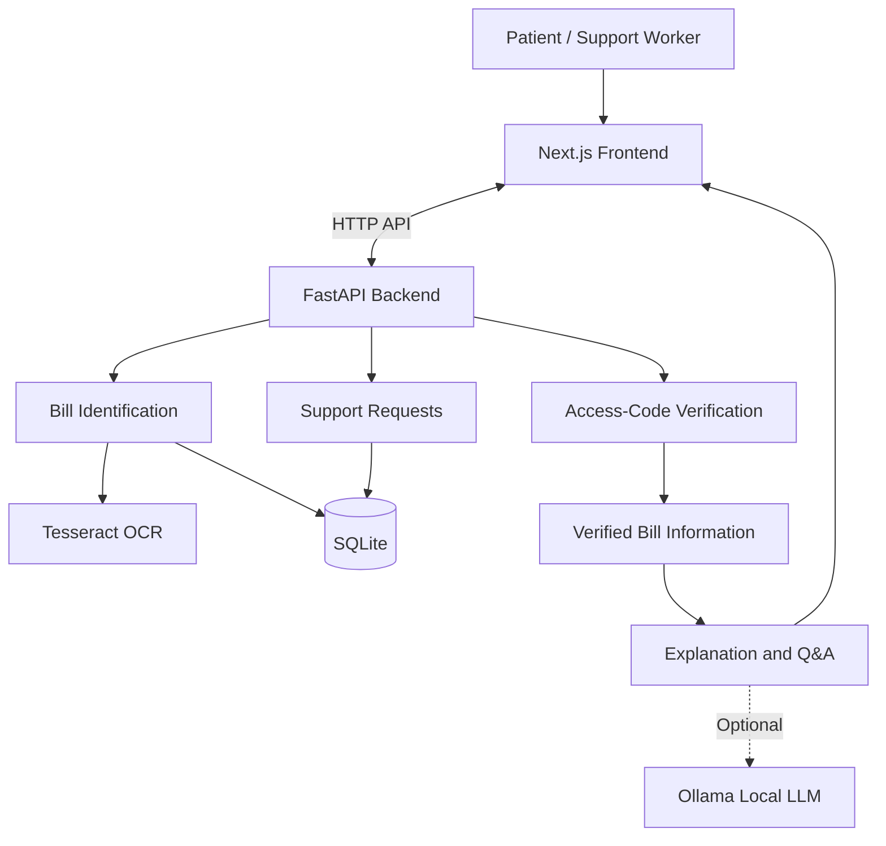
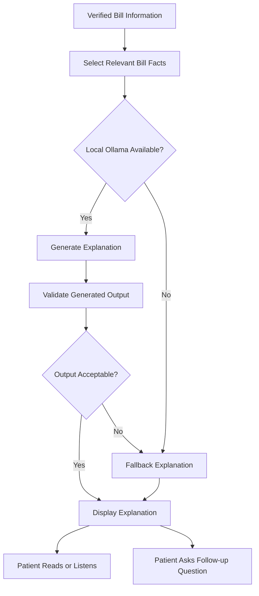

#  Healthcare Bill Navigator

A web application that helps patients understand hospital bills through bill identification, access-code verification, AI-assisted explanations, and human-support requests.

> **Note:** This project is a prototype using fictional bill records. It is not connected to real hospitals or insurance providers.

##  Tech Stack

| Layer | Technologies |
|---|---|
| Frontend | Next.js 15, React 19, TypeScript, Tailwind CSS 4 |
| Backend | Python, FastAPI, Pydantic v2 |
| Storage | SQLite |
| OCR | Tesseract, Pillow, pytesseract |
| GenAI | Ollama, Qwen3 1.7B (optional, local inference) |
| Frontend Testing | Vitest, React Testing Library |
| Backend Testing | Pytest, HTTPX |
| Code Quality | TypeScript, ESLint, Ruff |

##  System Architecture



##  Application Workflow

1. **Consent:** The patient reviews and accepts the consent requirements.
2. **Bill Identification:** The patient enters a bill number or uploads a bill image.
3. **OCR and Matching:** The backend extracts text from an image, when OCR is available, and searches the fictional bill registry.
4. **Access-Code Verification:** The patient verifies access using the code associated with the demo bill.
5. **Bill Information:** Authorized users can view available bill details.
6. **AI-Assisted Explanation:** The application provides simplified explanations and supported bill-related answers.
7. **Human Support:** The patient can submit a demonstration support request and track its status.

## 🤖 GenAI Feature Flow



### GenAI Safeguards

- Uses a local Ollama model; no cloud AI provider is required.
- Generates explanations from available bill information.
- Supports fallback responses when the model is unavailable or its output cannot be used.
- Does not replace the hospital's official bill or professional advice.
- Fictional records remain clearly labelled as demonstration data.

To enable local GenAI, install Ollama and download the configured model:

```powershell
ollama pull qwen3:1.7b
```

GenAI is optional; supported fallback behavior may be available without it.

##  Run Locally

### Requirements

- Windows
- Python 3.11+
- Node.js and npm
- Tesseract OCR for photo-based identification
- Ollama for optional local GenAI

### Quick Start

Extract the project so `hackloop2`, `hackloop3`, and `RUN-LOCAL.cmd` are in the same directory.

Run:

```cmd
RUN-LOCAL.cmd
```

Open the application:

- **Frontend:** http://localhost:3000
- **Backend API Docs:** http://127.0.0.1:8000/docs
- **Backend Health:** http://127.0.0.1:8000/api/v1/health

### Manual Setup

**Backend — Terminal 1**

```powershell
cd hackloop2
py -m venv .venv
.\.venv\Scripts\python.exe -m pip install -r requirements.txt
.\.venv\Scripts\python.exe -m uvicorn app.main:app --reload --host 127.0.0.1 --port 8000
```

**Frontend — Terminal 2**

```powershell
cd hackloop3
npm ci
$env:NEXT_PUBLIC_API_BASE_URL = "http://127.0.0.1:8000"
npm run dev
```

##  Testing

**Frontend**

```powershell
cd hackloop3
npm test -- --run
npm run typecheck
npm run lint
npm run build
```

**Backend**

```powershell
cd hackloop2
.\.venv\Scripts\python.exe -m pytest -v --tb=short
```

Use the provided `VERIFY-LOCAL.cmd` if available to run the combined validation checks.

##  Data Storage

SQLite stores the local fictional bill registry and support tickets. Session, consent, and verification state may be held in memory and can reset when the backend restarts.

The database is for local demonstration purposes only.

##  Limitations

- No real hospital or insurer integration.
- OCR extracts text but does not prove that a bill is genuine.
- The registry contains fictional records.
- Support tickets do not trigger real calls or notifications.
- Local AI is optional and may use fallback responses.
- The application is not intended for real medical, insurance, or payment decisions.

##  Project Goal

Healthcare Bill Navigator demonstrates how accessible frontend design, API-driven backend workflows, OCR, local GenAI, and human-support workflows can help users understand complex hospital-bill information.

**Built as a prototype for clearer, more accessible healthcare billing information.**
